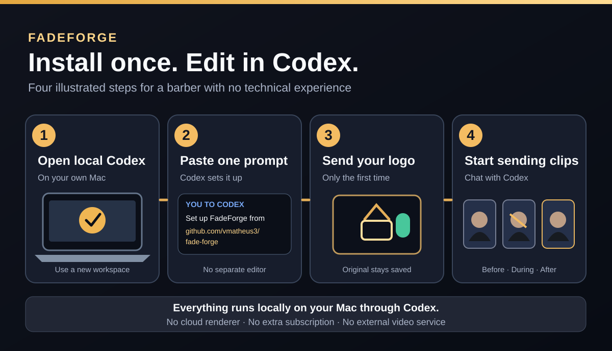
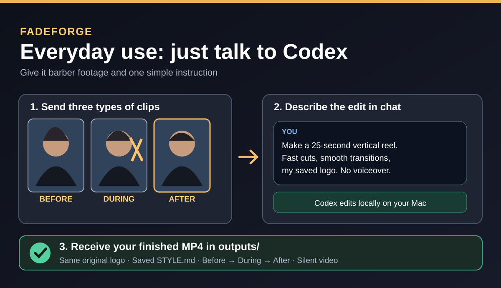

# FadeForge | Barber video editing inside Codex

**Upload barber clips. Describe the edit in chat. Get a branded MP4.**

FadeForge is a free, standalone **local Codex skill for barbers**, not a hosted
website or subscription video-editing service. It uses **native Apple Swift +
AVFoundation** for cuts, speed-ups, transitions, video framing, labels and a saved
logo. No cloud deployment, paid editors, external APIs, video uploads to a vendor,
FFmpeg installation or Docker.

> **Current status: v0.1 Mac-only prototype.** The code and docs are here, but the
> video exporter still requires validation on a real Mac. Please do not present it
> as fully tested. For local Codex on a Mac, not generic ChatGPT Projects or cloud
> Codex runtimes without Mac access.

## First-time install (copy this into Codex)

Open Codex **on your Mac** and paste this entire message:

```text
Set up FadeForge for my barbershop from https://github.com/vmatheus3/fade-forge .
Create a NEW empty folder for it; keep it separate from all other projects.
Clone the repository and read its AGENTS.md and .agents/skills/fadeforge/SKILL.md.
Use only local Apple-native processing, no cloud, APIs, subscriptions or Docker.
Run ./bin/fadeforge check and tell me the real result. Then ask me for my logo,
optional older reference reels, and before/process/after clips. Preserve my original
logo until I explicitly replace it. Save future preferences in brand/STYLE.md.
Give me the actual finished MP4 path after each edit, never an invented result.
```

Or copy the expanded version: [FIRST_MESSAGE_TO_CODEX.txt](FIRST_MESSAGE_TO_CODEX.txt).

## Two-picture guide

[](docs/BEGINNER_GUIDE.md)

[](docs/BEGINNER_GUIDE.md)

[Read the beginner-friendly guide](docs/BEGINNER_GUIDE.md).

## Everyday chat workflow

Tell Codex:

> Here is my BEFORE video, the haircut PROCESS, and the AFTER reveal. Make a
> 25-second vertical reel with quick process cuts, short dissolves, my saved logo,
> and a longer final after shot. No voiceover.

If Codex cannot access your chat-uploaded files, put videos in the project's
`media/before`, `media/process`, and `media/after` folders; Codex can then run the
renderer locally for you. You do **not** need to learn terminal commands.

## Features in v0.1

- Same logo preserved byte-for-byte once uploaded. Replacing it is a separate,
  explicit action, never automatic.
- Personal preferences persist privately in `brand/STYLE.md` (automatically initialized from a tracked example and excluded from Git).
- One or more clips per phase: before → process → after.
- Cuts, quick process-speed changes, short dissolves, optional labels and
  portrait center-crop export.
- Rough reference-video shot rhythm analysis; not AI subject recognition.
- Silent 9:16 MP4, no voiceover or soundtrack by default.
- Original media is never changed. Logos, custom style settings, media, and exports are gitignored.

## Command reference for Codex

```sh
./bin/fadeforge check
./bin/fadeforge status
./bin/fadeforge save-logo --file /absolute/path/logo.png
./bin/fadeforge analyze-reference --file /absolute/path/previous-reel.mov
./bin/fadeforge render --before /path/before.mov --process /path/cutting.mov --after /path/after.mov
```

The script compiles Swift automatically on first use. Apple's free Command Line
Tools are required on macOS (Codex can help with the prompt if missing).

## Scope and limitations

This repository is an **independent barber-only project**. No files, designs,
client information, or code from another project are included. It's a local skill,
not a standalone chat service: Code execution and video access depend on the user's
local Codex workspace. In this version, users identify clip phases themselves.

See [technical notes and Mac validation checklist](docs/TECHNICAL_NOTES.md).

MIT licensed. Contributions welcome after first real Mac export verification.
